# QuantFinance

**O laboratório quantitativo que eu uso para montar e gerir a minha carteira de ações real na B3:** otimização de Markowitz, Monte Carlo, detecção de regime (Markov/HMM), machine learning, valuation e um analisador que junta tudo num veredito de 0 a 100.

Todos os números e gráficos abaixo vêm **da minha carteira e das minhas operações de verdade**: extrato de movimentação da B3 (2025–2026), notas de corretagem e a posição atual na corretora.

  [](https://www.linkedin.com/in/viniciusbernardino01/)

---

## Resultados em 30 segundos

| | |
|---|---|
| **Operações reais analisadas** | 60 ordens · **28 vendas** · jan/2025 → out/2026 |
| **Resultado realizado** | **R$ +2.043** (preço médio, sem taxas) · acerto de **68%** · ganho médio R$ 127 × perda média R$ 46 |
| **Melhores trades** | TOTS3 **+35%** e EQTL3 **+37%** (out/2026) · PETR4 **+3,9%** (200 ações a R$ 38,20 sobre preço médio de R$ 36,76, fev/2026) |
| **Carteira atual** | CPLE3 · ITSA4 · VIVT3 · PSSA3 (+ caixa) · **+11,4%** sobre o custo |
| **Markowitz** | carteira atual: Sharpe **0,73** · o máximo Sharpe da fronteira: **0,87** com a mesma vol (18%) |
| **Monte Carlo (1 ano, 10 mil caminhos)** | VaR 95% **−3,5%** · CVaR 95% **−10,9%** · P(bater o CDI) **76%** |
| **Pesos atuais × IBOV (3 anos)** | **2,3x contra 1,8x** do IBOV no mesmo período |

> Valores de out/2026. Para reproduzir: `python carteira/analise_carteira.py` (preços atualizados do Yahoo).

---

## 1. Meus trades reais

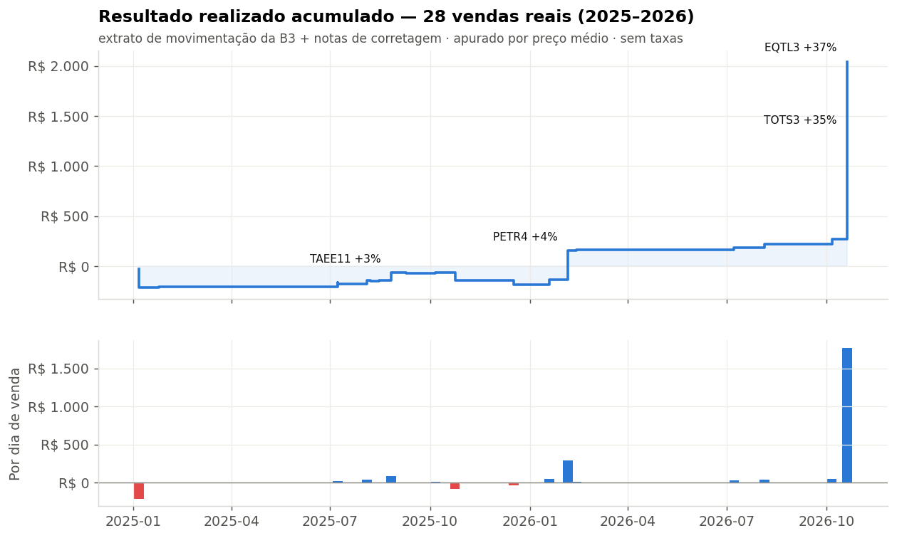

Cada degrau é uma venda real. A apuração usa **preço médio ponderado** (a regra da Receita, igual ao que a corretora informa), não FIFO. 2025 foi o ano de ajuste: limpei posições antigas que não faziam sentido (RANI3, SOJA3, BBAS3) e girei muito em operações curtas. Em 2026 mudei o processo — menos operações, mais convicção, decisão apoiada nas ferramentas deste repositório — e o resultado realizado do ano chegou a **R$ +2.224 em 11 vendas, 10 no lucro**.

| Ano | Vendas | Resultado | Acerto |
|---|---:|---:|---:|
| 2025 | 17 | R$ −181 | 53% |
| **2026** | **11** | **R$ +2.224** | **91%** |

### Petrobras (PETR4): a posição do fim de 2025

Comprei PETR4 em lotes entre setembro de 2025 e o começo de 2026, sempre na faixa de R$ 30–32 (92 ações a R$ 30,74 em set/25, 120 a R$ 31,41 em dez/25, 92 a R$ 30,20 e 120 a R$ 31,79 em jan/26), e completei a R$ 36,13 e R$ 37,58 na alta de janeiro. Saí no topo do movimento: **200 ações a R$ 38,20 em 05/02/2026 (+3,9% sobre o preço médio de R$ 36,76)** e o resto a R$ 37,00 e R$ 38,00 (+0,7% e +1,7%). As saídas de fevereiro somaram **R$ +299, ou +3,6%** sobre o custo, em 8 dias de posição. Somando o ciclo inteiro desde set/25, com as quatro saídas sem preço estimadas pelo fechamento, foram R$ +222 (+1,0%). No período a ação ainda rendeu aluguel (BTC) — R$ 24,99 de reembolso de empréstimo no informe de 2025.

> Quatro saídas parciais de PETR4 (out/25, dez/25 e jan/26) aparecem no extrato da B3 **sem preço**. No CSV elas estão com o fechamento do dia e marcadas como *preço estimado*.

Base: [`carteira/dados/round_trips.csv`](carteira/dados/round_trips.csv) · motor: [`carteira/trades_b3.py`](carteira/trades_b3.py)

## 2. A carteira hoje

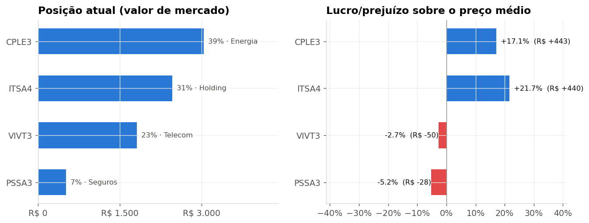

Estratégia: **BESST** do Barsi (Bancos, Energia, Saneamento, Seguros, Telecom) + dividendos, com preço de entrada pelo **método Bazin**.

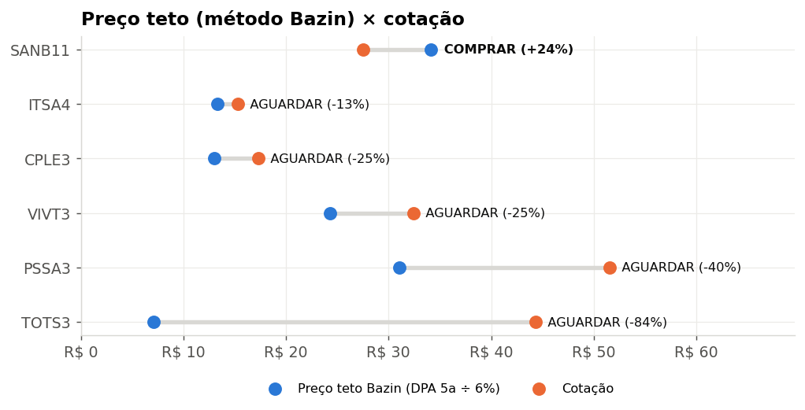

## 3. Markowitz — a fronteira eficiente da minha carteira

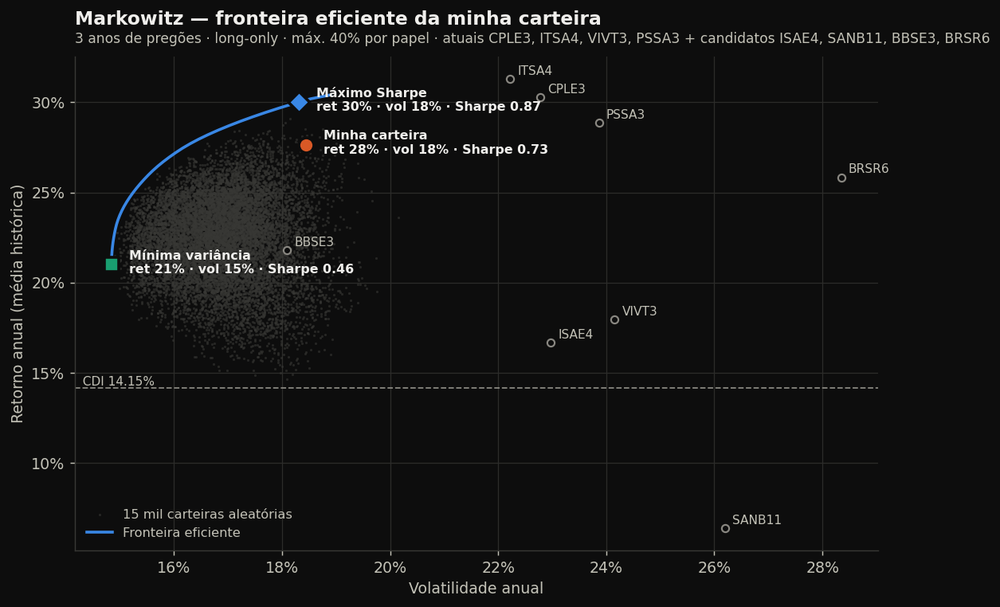

Fronteira calculada com 3 anos de retornos diários dos 4 papéis que tenho + os 4 candidatos que estudei para a última troca, **long-only e com teto de 40% por papel** (sem o teto, o otimizador concentra tudo em 1–2 ações, o que ninguém deveria fazer na vida real). Taxa livre de risco = CDI.

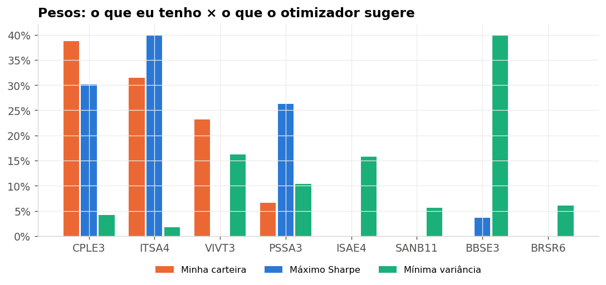

O que eu tirei disso: a minha carteira está **perto da fronteira** (mesma vol do máximo Sharpe, ~2 p.p. a menos de retorno). O otimizador zera VIVT3 (o pior Sharpe dos 4 que tenho) e pede mais PSSA3, que tem uma das **menores correlações** com o resto:

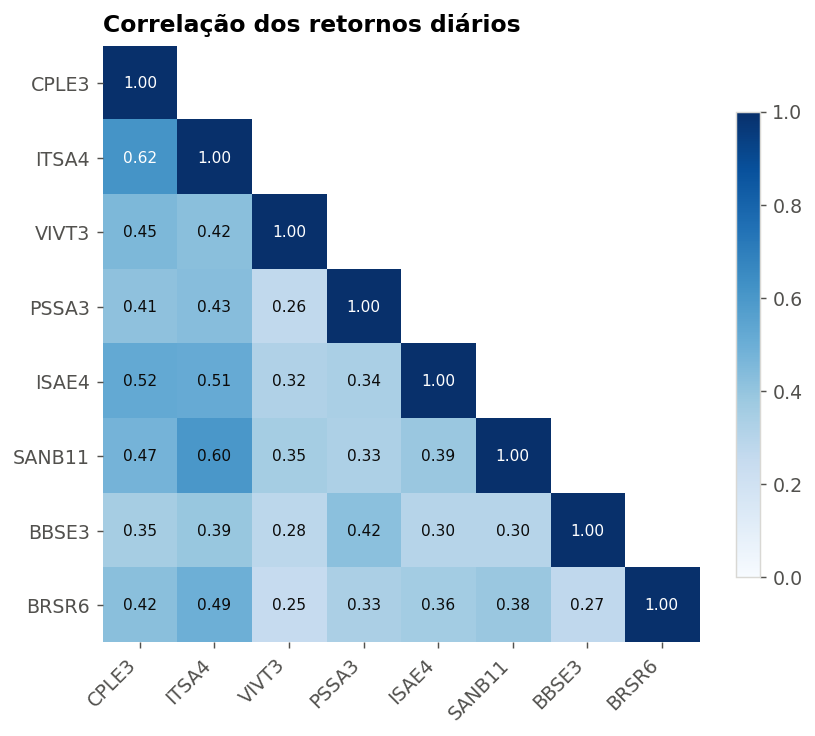

## 4. Monte Carlo — 10.000 futuros possíveis para a carteira

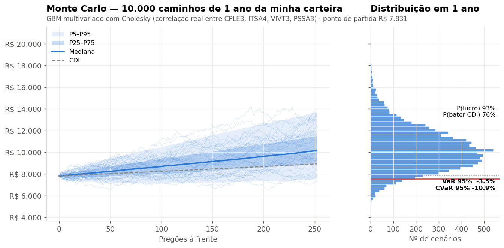

GBM **multivariado**: os choques diários são correlacionados via **decomposição de Cholesky** da matriz de covariância real, então o modelo sabe que CPLE3 e ITSA4 tendem a cair juntas. Daí sai o VaR/CVaR da carteira inteira, não de cada ação isolada.

> **Ressalva honesta:** o drift é a média histórica de 3 anos (~28% a.a.), um período bom para esses papéis. O número que eu levo a sério é a **cauda** (CVaR −10,9%), não a mediana.

Também rodo o Monte Carlo papel a papel. O da TOTS3 ([notebook 01](notebooks/01_monte_carlo_gbm.ipynb)), rodado em jun/2026 com o papel a ~R$ 29,50 (comprei a R$ 31,10), dava a média perto de R$ 34 e o percentil 95 perto de R$ 59. Vendi em outubro a **R$ 41,98 (+35%)**, dentro do cone:

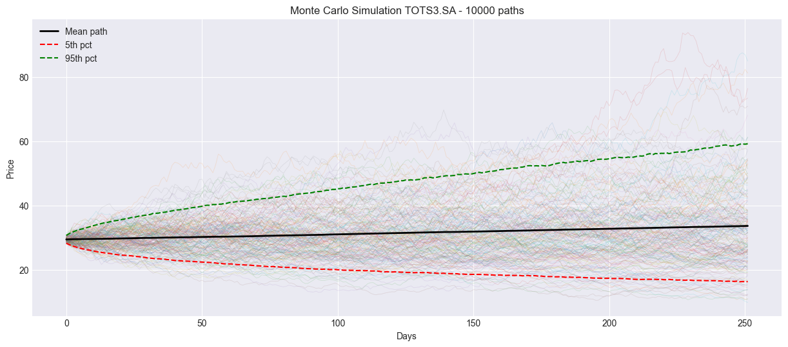

## 5. Risco: pesos de hoje × IBOV

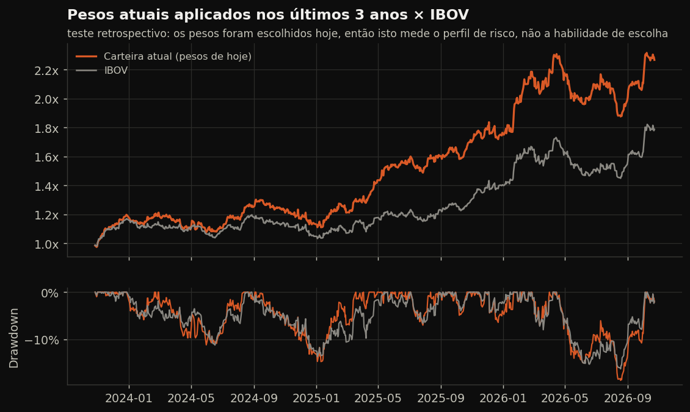

| Papel | Ret. a.a. | Vol a.a. | Sharpe | Sortino | Beta IBOV | Máx. DD |
|---|---:|---:|---:|---:|---:|---:|
| CPLE3 | 30,3% | 22,8% | 0,71 | 1,20 | 0,98 | −17,9% |
| ITSA4 | 31,3% | 22,2% | 0,77 | 1,30 | 1,17 | −19,3% |
| VIVT3 | 17,9% | 24,2% | 0,16 | 0,21 | 0,72 | −28,5% |
| PSSA3 | 28,9% | 23,9% | 0,62 | 0,90 | 0,68 | −19,3% |

Tabela completa (com os candidatos): [`resultados/risco_por_ativo.csv`](resultados/risco_por_ativo.csv)

## 6. Analisador — 9 metodologias, 1 veredito

Antes de comprar qualquer papel, eu rodo o `analisar.py`. Ele junta fundamentos, técnica, ML, regime e risco num score de 0 a 100. Saída real, rodada na minha carteira:

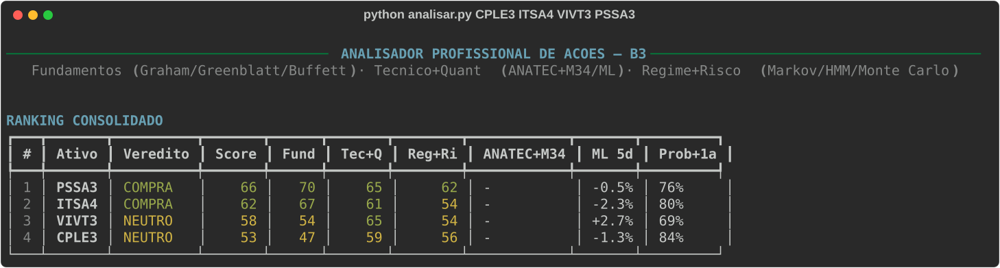

<details>
<summary><b>Relatório completo de um papel (CPLE3)</b></summary>

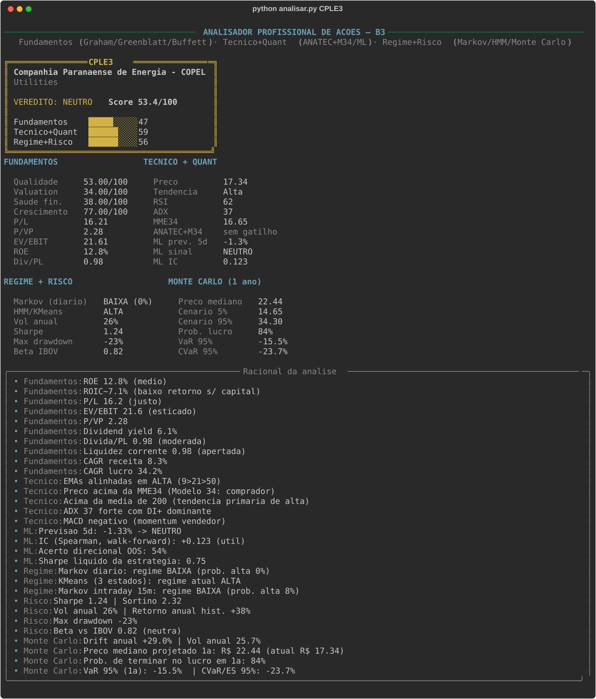

</details>

| Pilar | Peso | Métodos | Base teórica |
|---|---:|---|---|
| Fundamentos | 40% | qualidade, valuation, saúde, crescimento; Magic Formula | Graham, Greenblatt, Buffett, Damodaran |
| Técnico + Quant | 35% | ANATEC + Modelo 34, EMAs, Bollinger, RSI/MACD; **LightGBM walk-forward** com Information Coefficient | Elder, Bollinger, López de Prado, Grinold & Kahn |
| Regime + Risco | 25% | **Markov switching** (prob. filtrada, sem look-ahead), **HMM/KMeans**, Sharpe/Sortino/DD/Beta, **Monte Carlo** (VaR/CVaR) | Hamilton, Rabiner, Sharpe, Markowitz, Hull, Glasserman |

Detalhes: [`analisador/README.md`](analisador/README.md)

---

## O que os dados me ensinaram

1. **No Brasil, o benchmark é o CDI, não o IBOV.** Toda decisão aqui é medida contra a Selic do mesmo período, e Sharpe e drawdown pesam tanto quanto o retorno.
2. **Giro alto não paga.** 17 vendas em 2025 deram R$ −181; 11 vendas com mais convicção em 2026 deram R$ +2.224.
3. **Markowitz sem restrição é inútil na prática.** O teto de 40% por papel é o que torna a resposta utilizável.
4. **Média de dividendos engana.** A média de DPA de 5 anos infla quem cortou dividendo ou teve um ano extraordinário. Antes de confiar no preço teto, confiro a renda conservadora = mín(média de 5 anos, últimos 12 meses) e a tendência do DPA.

---

## Estrutura

```
QuantFinance/
├─ carteira/                    ← a MINHA carteira
│  ├─ analise_carteira.py       ← Markowitz + Monte Carlo + risco + trades + Bazin → docs/img
│  ├─ trades_b3.py              ← extrato da B3 → ordens + resultado por preço médio
│  ├─ modelo_preco.py           ← ponto de compra estatístico (z-scores de preço, percentil, DY, drawdown) + backtest
│  ├─ proventos.py · selic.py   ← proventos (StatusInvest) e Selic acumulada (BCB SGS 4390)
│  └─ dados/                    ← carteira.json, trades.csv, round_trips.csv, selic_mensal.json
├─ analisador/                  ← analisador unificado (9 métodos → veredito 0-100)
│  ├─ analisar.py · ANALISAR.bat
│  └─ nucleo/                   ← tecnico, fundamentos, regime, ml, montecarlo, risco, veredito...
├─ notebooks/
│  ├─ 01_monte_carlo_gbm        ← GBM, VaR/CVaR por ativo
│  ├─ 02_ml_return_predictor    ← previsão de retorno multi-fator
│  └─ 03_lbo_model              ← modelo de LBO (valuation)
├─ radares/                     ← scanners do IBOV em tempo real (Markov, ANATEC/M34) com alerta no Telegram,
│                                  Magic Formula (Fundamentus) e agenda/arbitragem de proventos
├─ resultados/                  ← resumo.json, risco_por_ativo.csv, trades_por_ano.csv
└─ docs/img/                    ← todos os gráficos deste README
```

## Como rodar

```bash
pip install -r requirements.txt

python carteira/analise_carteira.py              # refaz todos os gráficos da carteira
python carteira/trades_b3.py movimentacao.xlsx   # extrato da Área do Investidor B3 → trades
python analisador/analisar.py PETR4 VALE3        # veredito 0-100
python radares/radar_markov_ibov.py --once       # varredura de regime no IBOV
```

Os radares mandam alerta no Telegram se as variáveis `TELEGRAM_TOKEN` e `TELEGRAM_CHAT_ID` estiverem definidas; sem elas, só imprimem no terminal.

**Fontes (todas gratuitas):** Yahoo Finance (preços), Banco Central SGS 12/4390 (CDI/Selic), Área do Investidor B3 (operações), StatusInvest e Fundamentus (fundamentos e proventos).

---

**Quer conversar sobre o projeto ou uma vaga?** Me chama no [LinkedIn](https://www.linkedin.com/in/viniciusbernardino01/).

*Projeto pessoal de estudo. Nada aqui é recomendação de investimento.*
